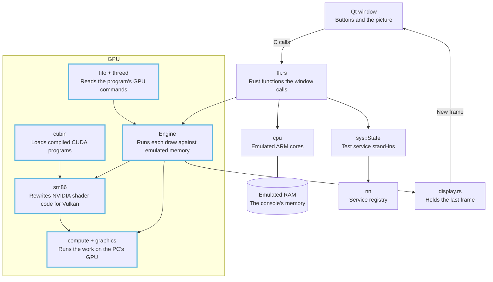

# Architecture

The emulator is made of a Qt window, emulated ARM cores, a kernel, a small stand-in service layer, an audio renderer and a GPU emulator. The included demos are the project's own AArch64 images and use those layers to draw, play sound and present a frame. Nintendo's OS is not emulated.

*The whole emulator. Blue outlines mark the GPU work.*

## Which page answers what?

| Page | Question it answers |
|---|---|
| [Emulator overview](kokoromi-overview.md) | What was already there, and what each part does today |
| [CPU and shared memory](cpu.md) | How the cores run ARM code, share memory with the GPU, and what the kernel layer adds |
| [Services](services.md) | How the test programs reach the stand-in services |
| [Audio](audio.md) | How the audio renderer mixes and presents sound |
| [Emulator path](guest-path.md) | How an included program reaches the GPU, audio and display services |
| [GPU pipeline](gpu-pipeline.md) | How a test program's draw command becomes pixels |
| [SASS translator](sass-translator.md) | How NVIDIA shader machine code becomes a Vulkan shader |
| [Vulkan backend](vulkan-backend.md) | How Kokoromi drives the PC's graphics card, and how it stays fast |
| [Command processor and memory](command-processor-and-memory.md) | How GPU commands are read, and how copies of memory stay correct |
| [Textures and tensors](textures-and-tensors.md) | How program images are decoded, and how matrix instructions are made exact |
| [Verification](verification.md) | How each instruction is proven against a real chip |
| [CUDA](cuda.md) | How compiled NVIDIA compute programs run as test programs |
| [Demos](demos.md) | What runs on the emulator today |
| [Roadmap](roadmap.md) | Current coverage and limits |
| [Glossary](../glossary.md) | Every term, in one plain sentence plus an example |

## Where are the design choices explained?

Each big choice has a decision record (ADR): the problem, the choice, and what it costs. Every record opens with a short "In plain words" section. They are listed under [decision records](../adr/README.md).

## Where should I start?

New to the code: read the overview, then the emulator path and GPU pipeline. Read verification before changing the translator.

Verified by: every page names its own checks in a "Verified by" line.

Sources: core/src/lib.rs, core/src/gpu/mod.rs, gui-qt/src/MainWindow.cpp, README.md.
