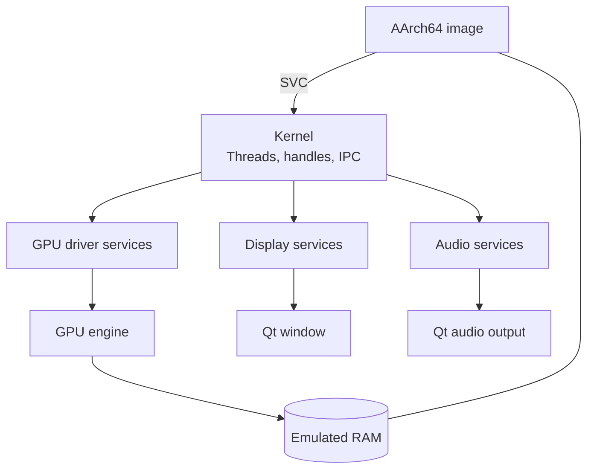

# Emulator path

The included demos are the project's own `no_std` AArch64 images. The loader places an image in emulated RAM, starts it on the emulated CPU and lets it drive the hardware through a small stand-in service layer. That layer follows known Switch 1 interfaces; Nintendo's OS is not emulated.

The images use the `aarch64-unknown-none` target and are built by `scripts/build-guest.sh`. Shared encoders in the `scene` crate build command lists, shader headers, texture headers and demo data without duplicating the oracle path.

## What runs through this path?

| Layer | Current support |
|---|---|
| Loader | NRO and flat images |
| Kernel | System calls, threads, scheduler, memory, events and IPC |
| GPU service stand-ins | Allocation, address mapping, channel submission and sync points |
| Display | VI, binder, dequeue, queue and present |
| Audio | Renderer updates, raw output and live sink |
| Input and files | HID state and SD-card-backed demo assets |

The Dungeon uses the full path for input, raster and ray-traced drawing, compute effects, display and measured-HRIR audio. The same runner drives the ray-traced BoomBox, the double-precision Mandelbrot dive and solar-system birth.

Tests keep direct reference renderers as oracles. The buttons and capture tool use the emulator path.

Verified by: the fixed-frame and PCM contracts in `core/src/guest.rs`, plus the loader, kernel, service and GPU suites.

Sources: `core/src/{guest,kernel}.rs`, `core/src/loader`, `core/src/nn`, `guest`, `scene`, `scripts/build-guest.sh`.
