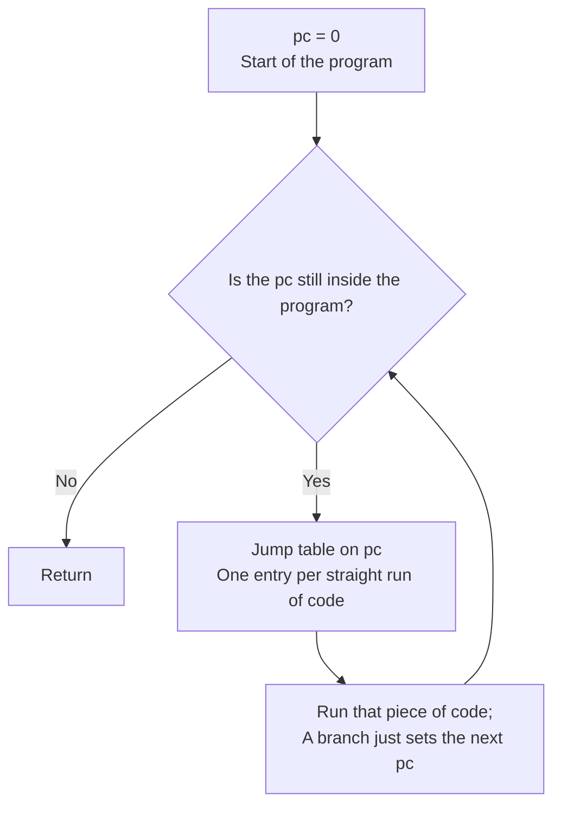

# SASS translator

Ampere GPUs run NVIDIA machine code called SASS, which an Intel or AMD card cannot run. The translator rewrites each SASS program into SPIR-V, the shader format every Vulkan driver accepts. For example, `FADD R0, R1, R2` becomes "load the source registers from an array, add them as floats, store the sum".

## How are instructions decoded?

A generator reads the instruction table NVIDIA's disassembler, nvdisasm, carries, and writes the decoder as Rust code. Each row of that table, an encoding class, becomes one branch of the decoder. Each branch calls a handler, the function that emits SPIR-V for one instruction family.

| Decoder fact | Value |
|---|---|
| Instruction word | 128 bits, scheduling bits included |
| Decoder key | Bit 91 plus bits 11:0 |
| Generator | `scripts/decoder_generator.rs` reads `scripts/sm_86_instructions.txt` |
| Output | `sm86_decoder_generated.rs` |
| Alternate-syntax classes | Skipped, so a shorthand never hides the real instruction |
| Unknown word | Panics |

Why the translator uses the SM86 table for its Switch 2 target: NVIDIA's disassembler ships byte-identical tables for SM86 and SM88. No Switch 2 shader has been used to validate that choice. See [ADR-0007](../adr/0007-t239-decodes-with-the-sm86-table.md).

## Where does the emulated GPU state live?

SPIR-V has no direct way to name the emulated GPU's hardware registers. Each register therefore becomes an entry in an array the shader owns. "Private" below means one copy per thread, and "Workgroup" means one copy shared by a group of threads.

| Emulated state | Home in SPIR-V | Note |
|---|---|---|
| Registers R0 to R253, RZ | Private array of 32-bit words | RZ always reads zero |
| Predicates P0 to P6, PT | One Private word of bits | One-bit "run this?" flags; PT is always true |
| Uniform registers UR0 to UR62, UP | The same array, after the predicates | Values shared by a whole warp |
| Live flag | Last word of the array | Finished threads start past the end |
| pc, return addresses, BSSY tokens B0 to B15 | Private variables | The program position and the rejoin markers |
| Local memory | Private array | 4 KiB per thread |
| Shared memory | Workgroup array | 1 KiB per workgroup |
| Warp exchange, schedule slots | Workgroup arrays | Where threads swap values and vote |

## How do jumps work without goto?

*The fallback turns machine-code jumps into one loop around a jump table.*

Vulkan only accepts structured control flow: nested loops and ifs, never a free jump. The Beyond Relooper structurizer now turns reducible machine-code control flow into nested SPIR-V selections and loops. Programs it cannot structure use the pc dispatcher shown above, where a branch stores the next program position and one loop runs the matching block.

Those pieces are basic blocks, runs of code with no jump in or out except at the ends. A block starts at the program start, at every jump target, after every branch and EXIT, at BSYNC and after BAR. A jump to an address held in a register (BRX, JMX, CALL) could land anywhere, so then every instruction starts a block. EXIT sets the pc past the end.

An instruction with a predicate, such as `@P0 FADD`, is wrapped in an if on that predicate. Uniform instructions check their uniform predicate instead.

## What happens when threads of a warp disagree?

A warp is the team of threads the chip runs in lockstep. When teammates take different sides of a branch, that is called divergence. Most programs never need teammates to meet again, so each thread simply runs its own pc loop.

Some instructions do need every teammate at the same place, because they swap values or wait for each other. Examples are VOTE, SHFL and BAR. A program that uses any of them runs in turns. In each turn, the threads furthest behind, those at the lowest pc, run one block. Threads at other pcs sit that turn out.

### An example

This program adds one on even threads only, then swaps a value with the next thread:

| Block | Code |
|---|---|
| A | Set a flag for even threads; odd threads jump to C |
| B | Add one to R1 |
| C | SHFL: read R1 from the next thread, then EXIT |

| Turn | Even threads wait at | Odd threads wait at | Who runs |
|---|---|---|---|
| 1 | A | A | Everyone runs A; even threads go on to B, odd threads jump to C |
| 2 | B | C | B is lower, so even threads run it; odd threads wait |
| 3 | C | C | Everyone runs C together, so every swap sees the updated R1 |

Without turns, odd threads would reach the swap first and read R1 before their even teammates had added one.

### The details

- The instructions that make a program run in turns: VOTE, SHFL, MATCH, REDUX, BAR, the tensor instructions, LDSM, MOVM and R2UR.OR.
- Swapped values travel through a shared array, with a barrier before and after.
- A thread that waits sits its turn out, and its memory writes are masked.
- BSSY gives each thread a token for where it should rejoin; BSYNC waits while a teammate holding the same token is still elsewhere.
- BAR counts arrivals per barrier and lets the threads go once all have arrived.
- A program that can never make progress marks itself stuck, and the test harness panics.

Why turns: every thread of a group must reach a Vulkan barrier together. And on lavapipe, Vulkan's own subgroups are narrower than a warp, so they cannot stand in for one. See [ADR-0003](../adr/0003-uniform-workgroup-scheduling-for-divergence.md).

## Which slots does a shader read its data from?

A Vulkan shader cannot follow pointers to its data. It reads from numbered slots, called bindings, and the host plugs a buffer or image into each slot before the run. A group of slots is a descriptor set. Compute and vertex shaders use set 0, and pixel shaders use set 1 with the same numbers.

| Binding | Kind | Holds |
|---|---|---|
| 0 | Uniform buffer, small and read-only | Kokoromi's own helper values, never game data |
| 1 to 32 | Uniform buffers | The game's constant buffers 0 to 31, stored as `uvec4` arrays |
| 33 | Storage buffer, large and read-write | The window onto emulated RAM |
| 34, 35 | Storage buffers | Register values in and out, tests only |
| 36 and up | Texture and image slots | Textures and writable images, in the order the shader first uses them |

A constant buffer, or cbuf, is a small read-only table the game hands the shader, such as the camera matrix. Vulkan's std140 layout rule pads every uniform array element to a fixed width. A `uvec4` fills that width exactly, so nothing is wasted.

| Layout fact | Value |
|---|---|
| std140 array element | Padded to 16 bytes |
| `uvec4` | Four 32-bit words, 16 bytes | See [ADR-0001](../adr/0001-set-0-binding-abi.md).

## Which kinds of shader are supported?

| Stage | Translator form | Stage-only instructions |
|---|---|---|
| Compute | `Stage::Compute { local_size }` | None |
| Vertex | `Stage::Vertex` | ALD and AST, attribute load and store |
| Fragment | `Stage::Fragment { flat, screen_linear, depth }` | IPA, attribute interpolation |

How smoothly a value blends across a triangle comes from the pixel shader's header, the SPH, not from IPA. Attributes are named by address:

| Attribute | Address |
|---|---|
| Position | 0x70 |
| Generic attribute n | 0x80 + 16n |
| Instance id | 0x2f8 |
| Vertex id | 0x2fc |
| Front facing | 0x3fc |

## How much is covered?

| Corpus | Handled |
|---|---:|
| CUDA sample kernels | 768 / 818 |
| GENGA instruction cases | 167 / 167 |

Compute, vertex, fragment, geometry, tessellation and ray-query programs all pass through the same translator. Remaining named failures cover unsupported runtime facilities and operations without a safe portable mapping, including sparse tensors, complete `FOOTPRINT` results and `BAR.SCAN` results.

## How are exact NVIDIA shaders built?

The NVIDIA driver is used on a desktop sm_86 card when exact SASS is required. The repository also carries a NAK offline compiler built from Mesa. Its binding shim lays out textures and uniform buffers the way the emulator expects and writes the shader header plus machine code.

| NAK result | Difference from driver output |
|---|---:|
| Triangle | Exact frame |
| Dungeon sprite | Exact frame |
| Sprites | Within 1 LSB |
| BoomBox PBR | Within 1 LSB |
| Ray-query fragment | Unsupported by the current offline compiler |

Verified by: spirv-val, the Khronos SPIR-V checker, on every emitted module; nvdisasm on every hand-built instruction word; and the silicon scoreboards (see [verification](verification.md)).

Sources: `scripts/decoder_generator.rs`, `core/src/gpu/sm86_decoder_generated.rs`, `core/src/gpu/sm86`, `tools/nak-offline.c`, `tools/nak-compile.sh`.
