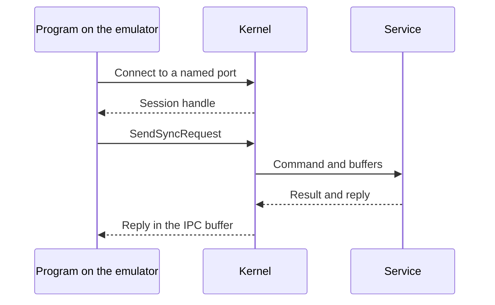

# Services

Games reach hardware-shaped features through system services. The kernel opens a named port, returns a session handle, parses the HIPC and CMIF request, calls the service object and writes the reply into the same IPC buffer.

## Which paths work?

| Area | Implemented path |
|---|---|
| Kernel IPC | Sessions, handles, domains, buffer descriptors and service dispatch |
| GPU driver | `nvdrv`, nvmap, address spaces, channels, sync points and submission |
| Display | VI sessions, binder and one real buffer slot |
| Audio | `audren` and `audout` |
| Input | HID state and vibration service surface used by the demos |
| Time and applet | The calls used by the included images |
| Filesystem | Files, directories and storage used by the loader and Dungeon assets |

The service registry still provides the broader foundation laid by the original project. Commands outside the implemented paths return errors. Switch 2-only command layouts remain unsupported when public documentation does not define them.

Verified by: the kernel IPC, nvdrv, VI, binder, audio, input, time, applet and filesystem tests, plus the end-to-end demo tests.

Sources: `core/src/kernel`, `core/src/nn`, `guest/src/{cmif,nv,display,audren}.rs`.
